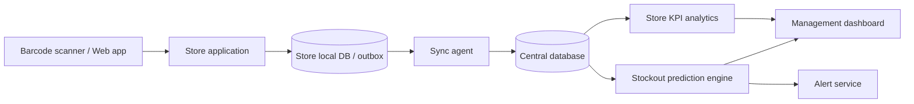

# System Design

## High-Level Design

The demo substitutes one SQLite database for physically separate store DBs. Each stock event carries a unique event UID and sync status. Central ingestion rejects duplicate event UIDs and batch UIDs.

## Medium-Level modules
Authentication/roles; SKU/store/supplier master; scan/sales; purchase orders; receiving; stock ledger; sync ingestion; prediction; stockout detection; supplier analytics; KPI engine; alerts; reporting; audit/reconciliation.

## Low-Level workflows
Sale: validate barcode → resolve SKU → validate quantity → calculate current balance → reject insufficient stock → append negative SALE event → audit → commit.
Receipt: validate PO and remaining quantity → append positive RECEIPT event → increment received quantity → set partial/received status → commit.
Sync: authenticate in production → validate schema and event UID → reject duplicate batch/event → persist accepted events → log accepted/rejected counts → acknowledge batch.
Out-of-order events: retain event occurrence timestamp and unique ID; production projection must recompute affected balance from ledger ordering. Demo balance uses additive deltas, so ordering does not change quantity.
Negative stock: sale is rejected by default. Authorized reconciliation may use explicit adjustment events; no historical row is edited.
Unknown barcode: show validation error; do not create a sale.
Duplicate scan: API clients should submit an idempotency/event UID; unique DB constraint prevents duplicate event IDs. UI confirmation is a deliberate action.

## ER model (summary)
- Store 1—many StockEvent, Alert, PurchaseOrder
- Category 1—many SKU
- Supplier 1—many SKU, PurchaseOrder
- SKU 1—many StockEvent, Alert, PurchaseOrder
- SyncLog stores unique batch receipt; AuditLog stores actor/action/detail.
Stock on hand is a projection: SUM(stock_event.quantity_delta) grouped by store and SKU; it is not independently editable.

## Database tables
Demo implements stores, product_categories, suppliers, sku, stock_event, alerts, purchase_orders, synchronization_logs, audit_logs. Production schema expansion should add users, roles, PO line items, goods receipt headers/lines, sales transaction headers/lines, stock_on_hand projection, supplier_performance, stockout_event, stockout_prediction, store_kpi_daily and reconciliation snapshots. Use BIGINT IDs, NUMERIC money, timestamptz, indexes on store/SKU/time, FK constraints, and event UID unique constraints in PostgreSQL.

## Class/data flow
SQLAlchemy entities map persistent records. `record_event()` is the single inventory write path. `current_predictions()` aggregates recent sales and stock balance. `store_kpis()` aggregates events. Streamlit pages call modules; modules own business rules.

## API contracts (production-ready design targets)
| Method | Endpoint | Request | Response |
|---|---|---|---|
| POST | `/scan/sale` | `{store_id, barcode, quantity, event_uid}` | `{event_uid, stock_after}` |
| POST | `/scan/receive` | `{store_id, sku_id, quantity, event_uid}` | `{event_uid, stock_after}` |
| POST | `/purchase-orders` | `{store_id, supplier_id, items:[{sku_id, quantity}]}` | `{po_id, status}` |
| POST | `/sync/events` | `{batch_uid, events:[{event_uid, store_id, sku_id, quantity_delta, occurred_at}]}` | `{accepted, rejected}` |
| GET | `/inventory/{store_id}` | query `sku_id?` | stock rows |
| GET | `/predictions` | store/category/risk filters | seven-day risk records |
| GET | `/store-performance` | date range | ranked KPI records |
| GET | `/alerts` | status/store filters | alert records |

JSON event example:
```json
{"event_uid":"uuid","store_id":1,"sku_id":12,"event_type":"SALE","quantity_delta":-2,"occurred_at":"2026-10-30T18:15:00Z","source":"store-terminal"}
```
Production integrations require HTTPS, OAuth2/client credentials, signed payloads, retries with exponential backoff, schema versioning, mapping governance, event-time ordering and dead-letter handling.

## ML methodology
Synthetic daily demand is generated with store-type multipliers, weekend effects and category/season variation. Features use trailing 14-day sales, stock proxy, demand variability, recent trend, weekday, weekend, lead time and reorder point. Target indicates whether next-seven-day demand exceeds sampled stock. Split is chronological 80/20 by example date. Metrics include accuracy, precision, recall, F1, ROC-AUC and confusion matrix. This synthetic target and dataset are for demonstration; a production model needs observed stockout labels, inventory snapshots, promotions, supplier ETA, calibrated probabilities and time-based backtesting.
